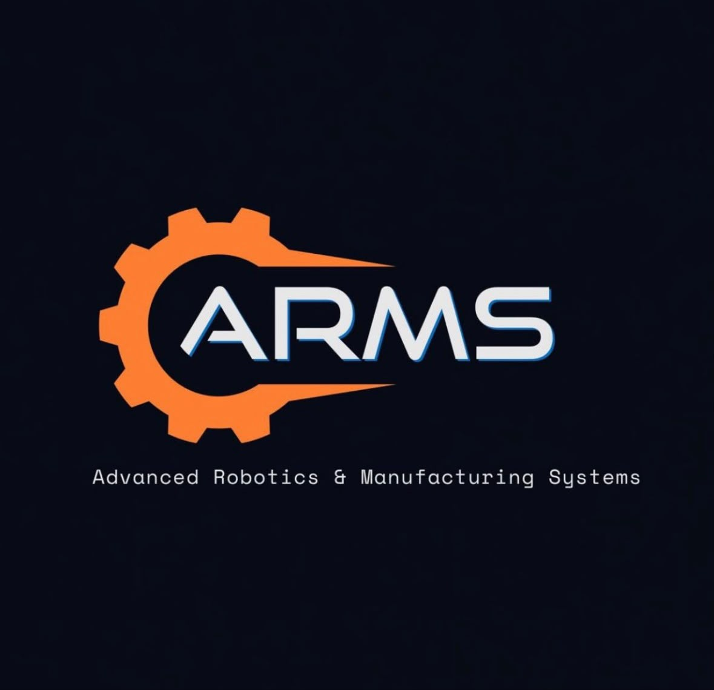

# ARMS @ ASU

**Advanced Robotics & Manufacturing Systems**

*Build. Compete. Teach. — Arizona State University, Polytechnic campus*

---

## Who we are

ARMS is a student-run robotics and manufacturing club at **Arizona State University**. We design, build, and program real machines — and we teach the skills to do it, from first solder joint to full competition robot.

## What we do

| | |
|---|---|
| **Build** | Hands-on projects: robot arms, mobile bases, electronics, CAD, machining and fabrication |
| **Compete** | Intercollegiate robotics competitions and hackathons |
| **Teach** | Workshops on robotics, electronics, and manufacturing open to every skill level |

## Connect

- Instagram: **[@a.r.m.s._robotics](https://www.instagram.com/a.r.m.s._robotics)**
- Email: **the.arms.robotics@gmail.com**
- Web: **[arms-asu.github.io](https://arms-asu.github.io)**

Mesa, AZ · Arizona State University Polytechnic

